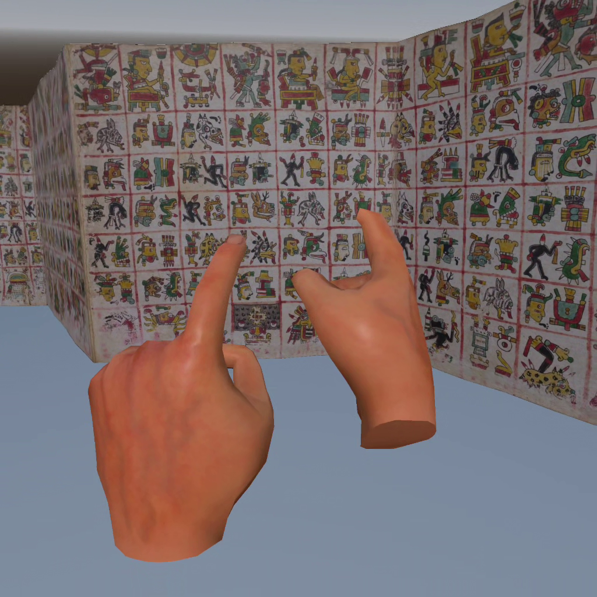

# PUREQuest Cospi: A proof of concept.

An experiment to use Godot's OpenXR tools to create a native PURE3D experience that can be used on Meta Quest VR platforms.

v0.3 presents the Codex Cospi, supports walking around the floor-plane (don't fall off!) and interacting with editions via grab-and-drop functionality. Resolution is surprisingly high and interaction with objects in this manner is extremely natural.

[POC recording](media/purequest-cospi-v0.3.mp4)

[](media/purequest-cospi-v0.3.mp4)

Goals for further iterations: reading svx files, placing annotations on objects, VR information panels and labels, actual walls (you can walk off the floor right now [hey, proof of concepts have these kinds of things!]), and continuing to refine the experience.

AI Disclosure: Chat GPT Sol used for configuration and removing the .glb file's Draco compression so Godot can run them. I walked through a custom tutorial, but the world was built manually upon the OpenXR demo world by myself.

## Technical notes

The decoded Codex Cospi model and textures are in [`assets/cospi/`](assets/cospi/). See [`assets/cospi/ATTRIBUTION.md`](assets/cospi/ATTRIBUTION.md) for source and rights information. [`tools/DRACO_CONVERSION.md`](tools/DRACO_CONVERSION.md) explains the Draco conversion. 

1. Download [PUREQuest-Cospi-v0.3.0.apk](https://github.com/22samurai/pure3d-webxr-metavr/releases/download/v0.3.0/PUREQuest-Cospi-v0.3.0.apk) from the [v0.3 release](https://github.com/22samurai/pure3d-webxr-metavr/releases/tag/v0.3.0).
2. Set up a [Meta developer account and Developer Mode](https://developers.meta.com/vr/documentation/native/android/mobile-device-setup/) for your headset. Install [Android SDK Platform-Tools](https://developer.android.com/tools/releases/platform-tools) on your computer and add its `platform-tools` folder to your PATH (or run the commands from that folder). Windows users also need the [Meta Quest ADB driver](https://developers.meta.com/vr/documentation/native/android/mobile-device-setup/).
3. Connect the Quest with a USB-C **data** cable, put it on, and accept the **Allow USB debugging** prompt. In a terminal, run `adb devices` and confirm the headset appears as `device`.
4. From the folder containing the downloaded APK, run:

   ```text
   adb install -r "PUREQuest-Cospi-v0.3.0.apk"
   ```

5. On the headset, open **Library → Unknown Sources** and launch **PUREQuest Cospi TEST**. If `adb devices` shows `unauthorized`, accept the debugging prompt inside the headset and run it again.

If you have a checkout of this repository on Windows, `deploy_quest.bat "C:\path\to\PUREQuest-Cospi-v0.3.0.apk"`will copy the APK to the Quest. 

## Build from source

Open the project in Godot 4.7.2 with matching Android export and build templates, then select the **Android Quest** export preset. The generated APK is ignored by Git and distributed through the GitHub release above.
